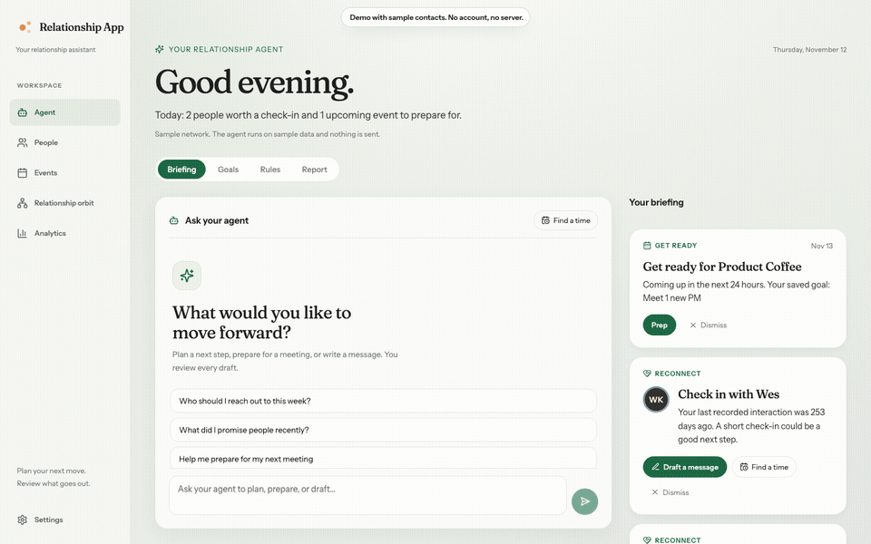
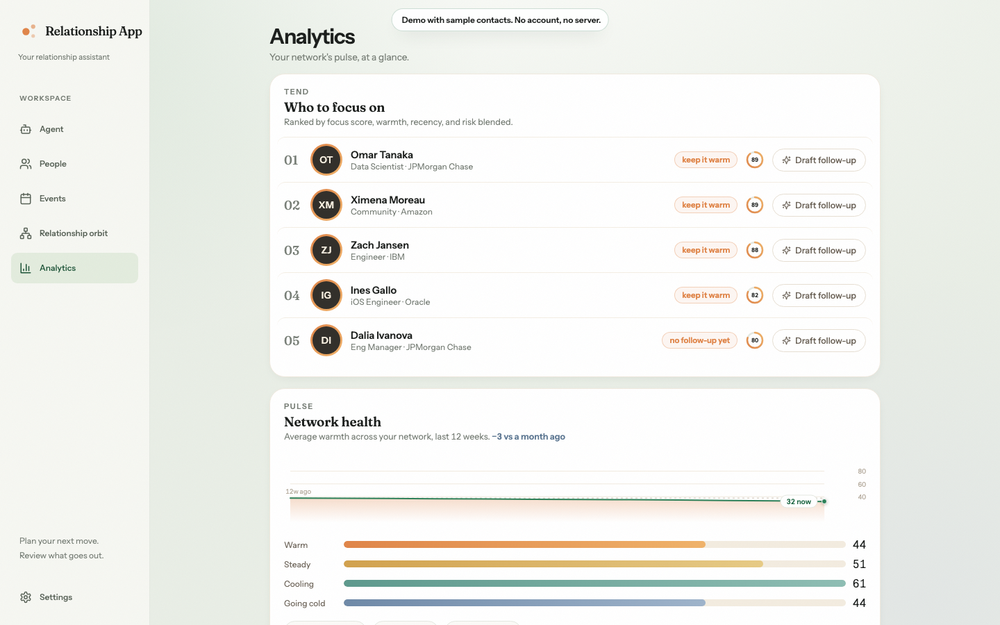
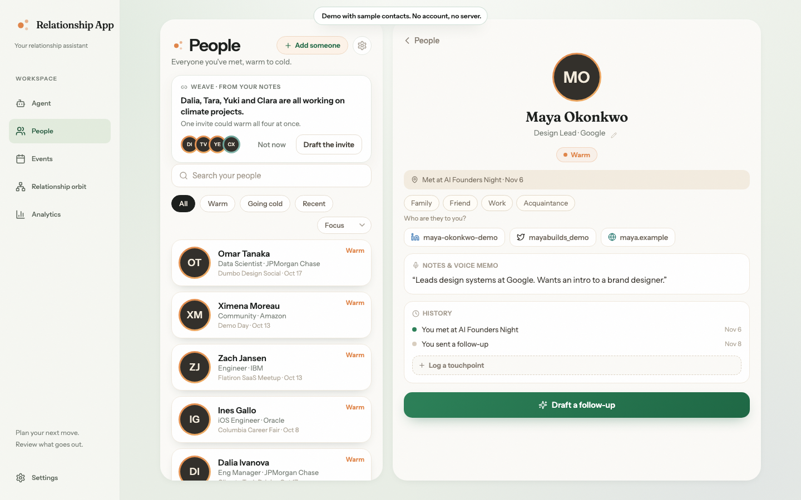
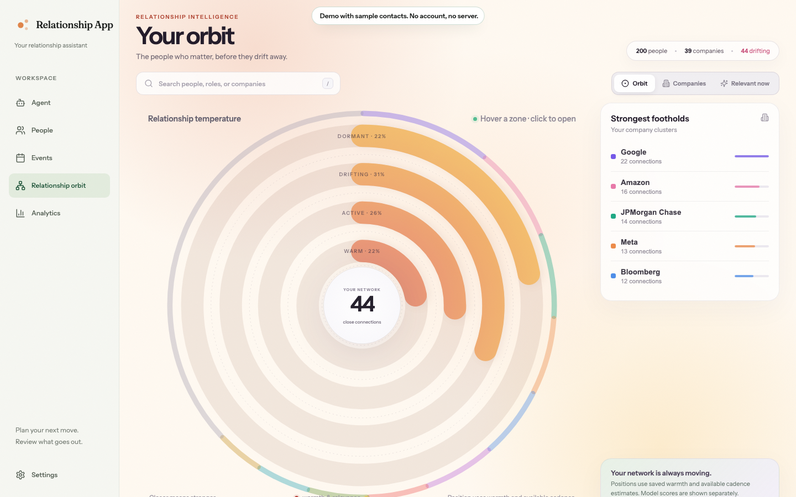
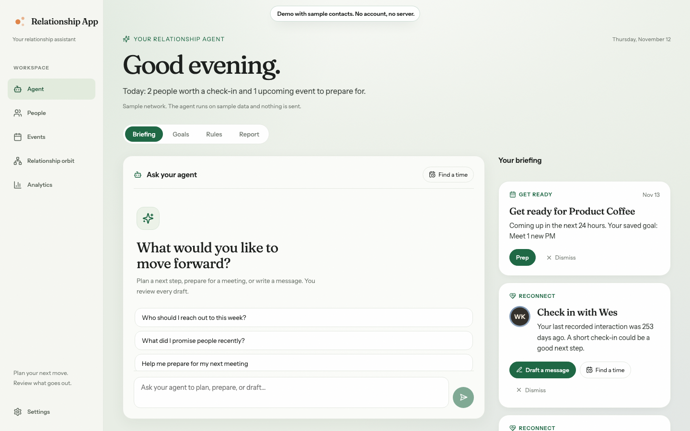
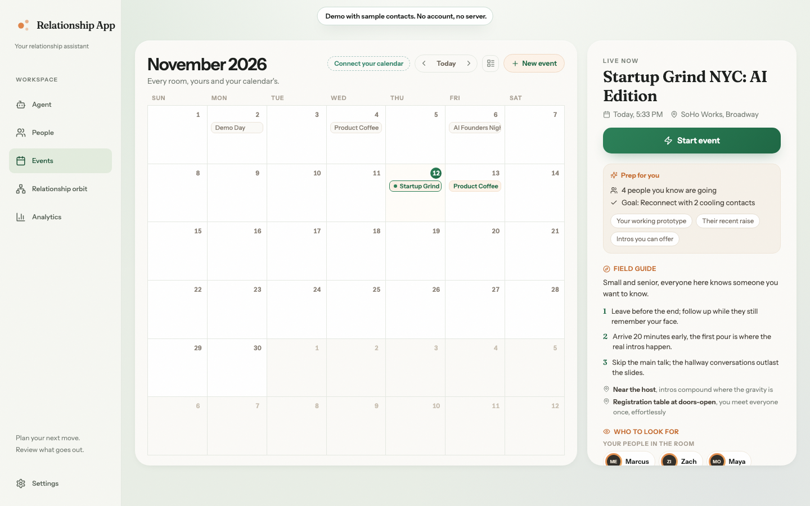

# Relationship App

A web app for people who network a lot. It shows which contacts you are losing touch with, why, and when to follow up. This repo is a demo that runs on made-up sample contacts.



## Screens

**Analytics.** Who to focus on first, each with a plain reason, then network health and the 12 week warmth trend.



**People.** Everyone you have met, warm to cold, with a card for each person showing where you met, your notes and your history.



**Orbit.** Each ring is a warmth band, from Warm in the middle to Dormant at the edge, with your biggest company clusters on the side.



**Assistant.** A daily briefing of who to check in with and what to prepare for, plus a chat that drafts messages for you to review.



**Events.** A calendar of events, with prep for the one happening now: who you know there and what to talk about.



## What it shows

- 200 sample contacts at 39 companies, each with where you met and a note.
- A People list ranked by who needs attention first, with Warm and Going cold filters.
- An orbit map that places each person by how warm the relationship is, with a Companies view that groups people by employer.
- An analytics page with network health, follow up rate, a 12 week warmth trend, results per event and the last 30 days against the 30 before.
- An assistant page that suggests who to contact today and writes a first draft for you to review. In the demo it uses simple built-in rules, not an AI model.

## How it works

- Every contact has a warmth score from 0 to 100 that sorts them into Warm, Steady, Cooling or Going cold. In this demo the sample contacts come with a score already set.
- The scoring code can also compare how long it has been since you last talked with that person's usual rhythm. It never raises an alarm before 45 days of silence, or while the silence is still within that rhythm.
- The focus list puts the people who need attention first, each with a plain reason such as "going cold" or "no follow-up yet".
- Each past event shows how many people you met, how many you followed up with, and how many are still warm.
- It runs in your browser on sample data, with no account and no server. Fonts are bundled with the app.

## Tech stack

TypeScript, React, Vite, Vitest.

## Run it

You need Node.js 20 or newer.

```sh
npm install
npm run dev
```

Then open the address it prints. To check the code:

```sh
npm test
npm run lint
npm run build
```
